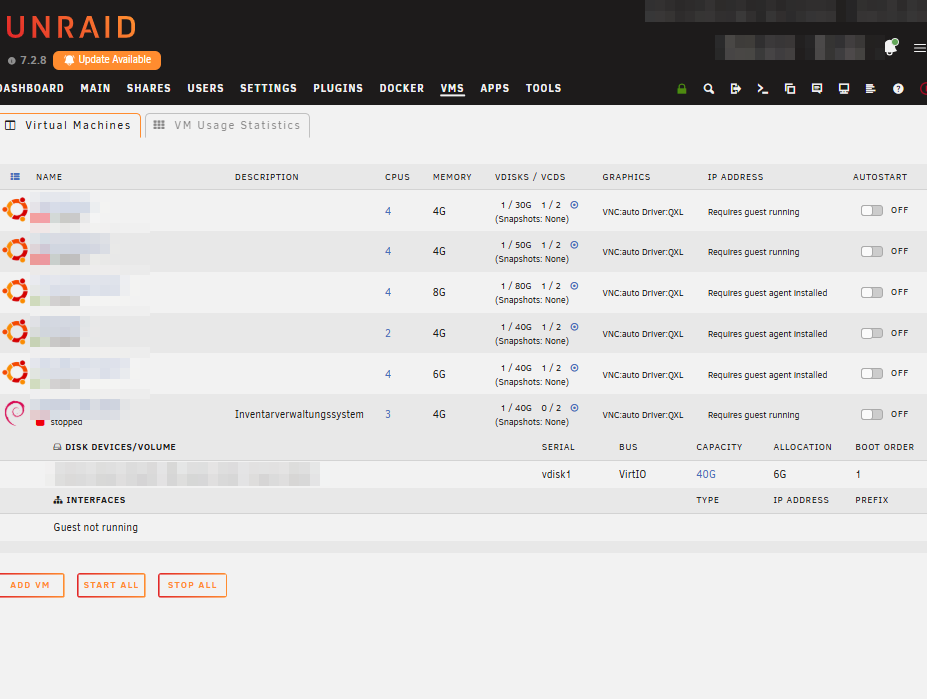
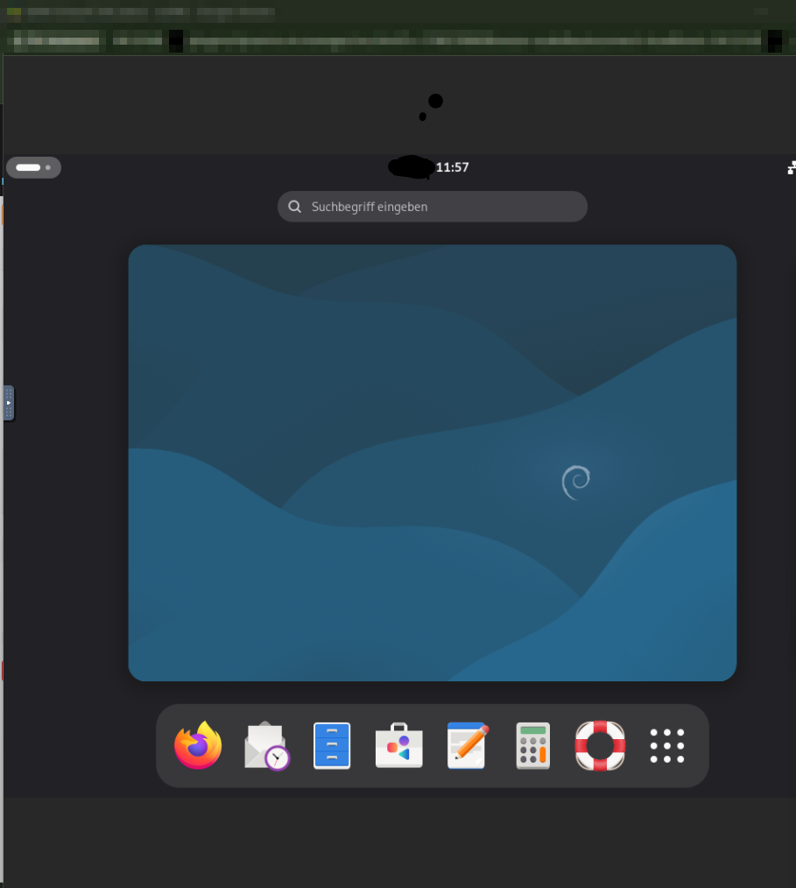
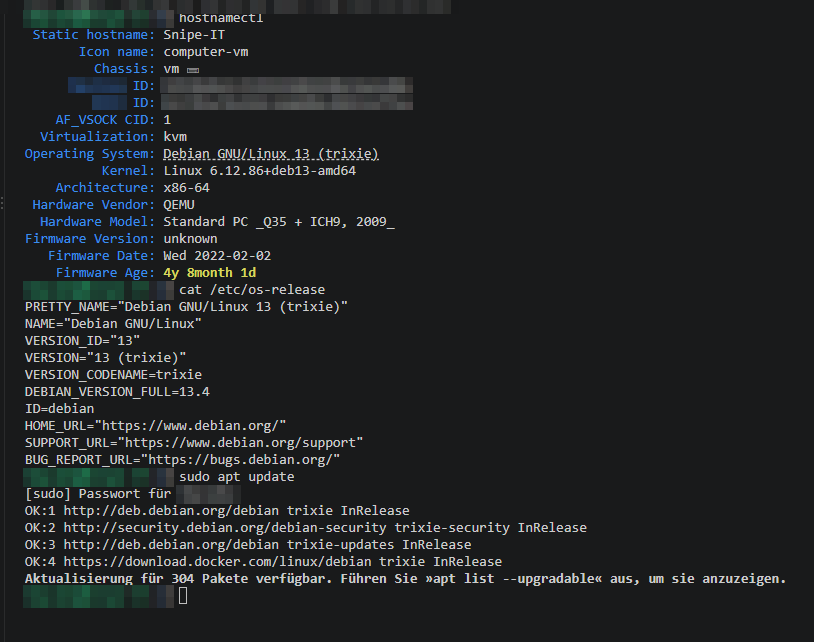

# 1 Einrichtung der virtuellen Maschine

[← Übersicht](../README.md) · [Weiter: Docker →](02_docker-installation.md)

## 1.1 Ziel

Für Snipe-IT wird eine eigene Debian-VM auf dem Unraid-Server des IT-Labors angelegt.
So ist die Anwendung von anderen Diensten getrennt und kann einzeln gesichert und neu gestartet werden.

## 1.2 Installationsmedium bereitstellen

Das Debian-Netinstall-Image (`debian-13.x.x-amd64-netinst.iso`) wurde im Unraid-Share `isos`
(`/mnt/user/isos`) abgelegt und nach der Installation wieder entfernt, um Speicherplatz freizugeben.

## 1.3 VM in Unraid anlegen

Unraid (Version 7.2.8, Server des Labors) → **VMs** → **Add VM** → Vorlage **Linux / Debian**.

| Einstellung | Wert |
|---|---|
| Name | `SnipeIT` |
| Beschreibung | Inventarverwaltungssystem |
| CPU-Kerne | 3 |
| RAM | 4 GB |
| Primary vDisk | `/mnt/user/domains/SnipeIT/vdisk1.img`, 40 GB, Bus VirtIO |
| OS Install ISO | `debian-13.x.x-amd64-netinst.iso` (nach der Installation entfernt) |
| Grafik | VNC, Treiber QXL |
| Autostart | aus |



## 1.4 Debian installieren

Installation über **Graphical install** bzw. **Install**:

- Sprache/Tastatur: Deutsch
- Hostname: `Snipe-IT`
- Benutzer: `itadmin` (mit sudo-Rechten)
- Partitionierung: geführt, gesamte Platte
- Softwareauswahl: Desktop-Umgebung **GNOME**, **SSH-Server** und **Standard-Systemwerkzeuge**


## 1.5 Problem: VM startet nach der Installation erneut den Installer

**Symptom:** Nach der Meldung „Installation abgeschlossen“ und dem Neustart erschien wieder das Installationsmenü.

**Ursache:** Das ISO-Image war weiterhin eingebunden und stand in der Boot-Reihenfolge vor der virtuellen Festplatte.

**Lösung:**

1. VM stoppen (ggf. **Force Stop**).
2. VM → **Edit** → `OS Install ISO` auf **None** setzen.
3. Boot Order prüfen: `vdisk1.img` = **1**.
4. **Update** und VM starten.

In der VM-Übersicht (Abbildung in 1.3) ist das Ergebnis zu sehen: `VCDS 0/2` (kein ISO eingebunden)
und `vdisk1` mit **Boot Order 1**.

## 1.6 Erster Login und Grundkonfiguration

Nach dem Neustart startet Debian 13.4 „trixie“ mit der GNOME-Oberfläche (Kernel `6.12.86+deb13-amd64`, Virtualisierung KVM/QEMU).



```bash
# Netzwerk prüfen
ip a
ping -c 4 debian.org

# System aktualisieren
sudo apt update
sudo apt upgrade -y
```



> Stand 05.10.2026: `apt update` läuft fehlerfrei (Debian- und Docker-Repository erreichbar),
> es stehen **304 Paket-Updates** aus. Sie werden nach einem Backup eingespielt.

## 1.7 SSH-Zugang

Die weitere Administration erfolgt per SSH vom Arbeitsplatz-PC (Git Bash im VS-Code-Terminal).
Vorteil gegenüber der VNC-Konsole: Befehle lassen sich per Copy & Paste einfügen, unabhängig vom Tastaturlayout der VM.

```bash
ssh itadmin@192.0.2.10
```

Falls der SSH-Server fehlt: `sudo apt install -y openssh-server` (in der VNC-Konsole).

**Ergebnis:** Debian 13 (Hostname `Snipe-IT`) läuft von der virtuellen Festplatte, hat Netzwerkzugang und ist per SSH erreichbar.
