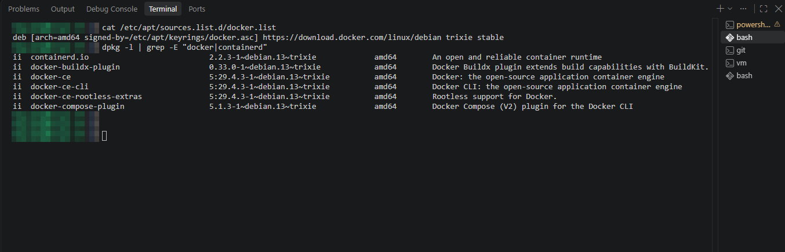
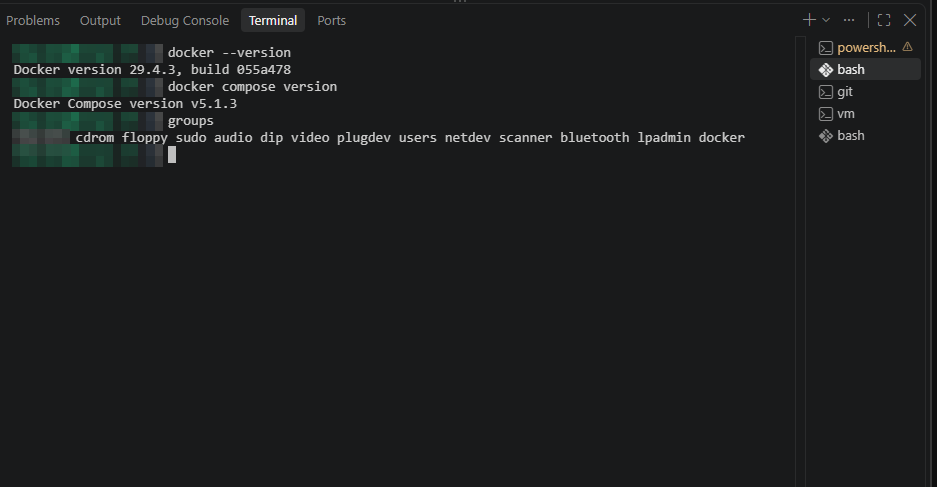
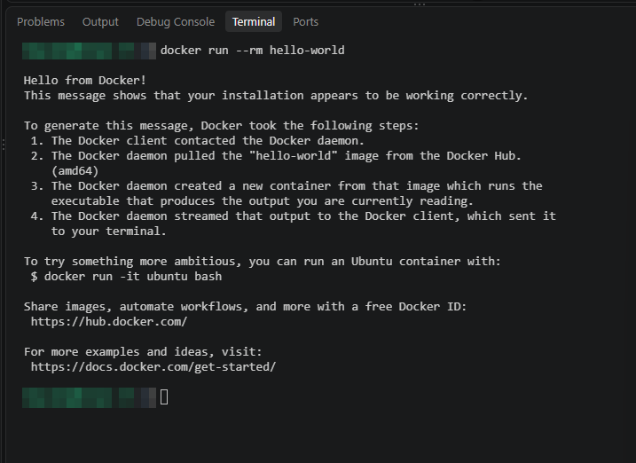

# 2 Installation von Docker

[← VM-Einrichtung](01_vm-einrichtung.md) · [Übersicht](../README.md) · [Weiter: Snipe-IT →](03_snipe-it-installation.md)

## 2.1 Ziel

Snipe-IT wird laut Herstellerempfehlung mit **Docker Compose** betrieben.
Docker wird aus dem offiziellen apt-Repository von Docker installiert (nicht aus dem Debian-Paket `docker.io`),
damit das aktuelle Compose-Plugin verfügbar ist.

## 2.2 Repository einrichten

```bash
sudo apt install -y ca-certificates curl
sudo install -m 0755 -d /etc/apt/keyrings
sudo curl -fsSL https://download.docker.com/linux/debian/gpg -o /etc/apt/keyrings/docker.asc
sudo chmod a+r /etc/apt/keyrings/docker.asc

echo \
  "deb [arch=$(dpkg --print-architecture) signed-by=/etc/apt/keyrings/docker.asc] https://download.docker.com/linux/debian \
  $(. /etc/os-release && echo "$VERSION_CODENAME") stable" | \
  sudo tee /etc/apt/sources.list.d/docker.list > /dev/null
```

## 2.3 Pakete installieren

```bash
sudo apt update
sudo apt install -y docker-ce docker-ce-cli containerd.io docker-buildx-plugin docker-compose-plugin
```

Kontrolle von Repository und installierten Paketen:

```bash
cat /etc/apt/sources.list.d/docker.list
dpkg -l | grep -E "docker|containerd"
```

| Paket | Version (Stand 05.10.2026) |
|---|---|
| `docker-ce`, `docker-ce-cli` | 29.4.3 |
| `docker-compose-plugin` | 5.1.3 |
| `containerd.io` | 2.2.3 |
| `docker-buildx-plugin` | 0.33.0 |
| `docker-ce-rootless-extras` | 29.4.3 |

Repository: `https://download.docker.com/linux/debian trixie stable`, signiert mit `/etc/apt/keyrings/docker.asc`.



## 2.4 Benutzer zur Gruppe docker hinzufügen

```bash
sudo usermod -aG docker itadmin
# danach ab- und wieder anmelden
```

Ergebnis: `itadmin` ist Mitglied der Gruppe `docker` (Kontrolle mit `groups`), Docker-Befehle laufen ohne `sudo`.

## 2.5 Test

```bash
docker --version
docker compose version
groups
docker run --rm hello-world
```

Ausgabe: `Docker version 29.4.3, build 055a478` und `Docker Compose version v5.1.3`.




**Ergebnis:** Docker Engine und Docker Compose sind installiert und funktionieren.
