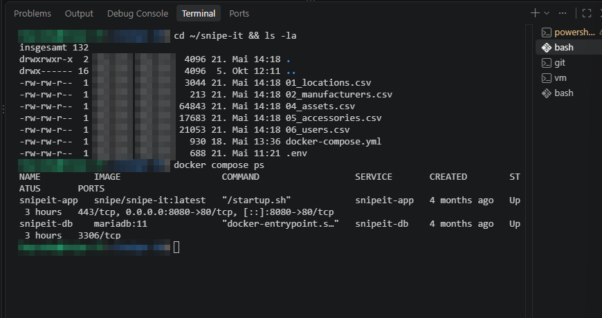
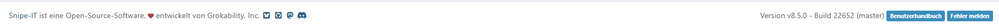
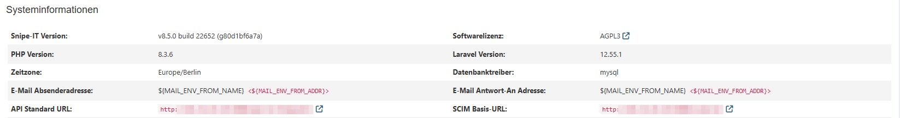

# 3 Installation von Snipe-IT

[← Docker](02_docker-installation.md) · [Übersicht](../README.md) · [Weiter: Datenmigration →](04_datenmigration.md)

## 3.1 Aufbau

| Container | Aufgabe |
|---|---|
| `snipeit-app` | Snipe-IT-Webanwendung (PHP/Laravel, Apache), Image `snipe/snipe-it:latest`, Port **8080 → 80** |
| `snipeit-db` | MariaDB-Datenbank, Image `mariadb:11` |

Compose-Projekt: `snipe-it`, Verzeichnis `/home/itadmin/snipe-it`.

Persistente Daten (Uploads, Backups, Datenbank) liegen in Docker-Volumes und bleiben beim Neustart oder Update der Container erhalten.

## 3.2 Projektverzeichnis anlegen

```bash
mkdir -p ~/snipe-it        # = /home/itadmin/snipe-it
cd ~/snipe-it
```

Inhalt des Projektverzeichnisses (Stand 05.10.2026):

| Datei | Erstellt | Zweck |
|---|---|---|
| `docker-compose.yml` | 18.05.2026 | Definition der Container |
| `.env` | 21.05.2026 | Umgebungsvariablen inkl. Passwörter und `APP_KEY` – **nicht im Repo** |
| `01_locations.csv` … `06_users.csv` | 21.05.2026 | Importdateien für die Datenmigration (siehe Kapitel 4) |

Die Dateien `docker-compose.yml` und `.env` wurden auf Basis der offiziellen Vorlage von Snipe-IT erstellt.
Bereinigte Versionen (ohne Passwörter) liegen in diesem Repository:

- [config/docker-compose.yml.example](../config/docker-compose.yml.example)
- [config/env.example](../config/env.example)

## 3.3 Wichtige Einstellungen in `.env`

| Variable | Wert / Bedeutung |
|---|---|
| `APP_PORT` | `8080` |
| `APP_URL` | `http://192.0.2.10:8080` |
| `APP_TIMEZONE` | `Europe/Berlin` |
| `APP_LOCALE` | `de-DE` |
| `APP_KEY` | per `artisan key:generate` erzeugt, **nicht im Repo** |
| `DB_HOST` | `snipeit-db` |
| `DB_PASSWORD`, `MYSQL_ROOT_PASSWORD` | sichere Passwörter, **nicht im Repo** |
| `MAIL_MAILER` | `log` (E-Mails werden nur protokolliert, SMTP noch offen) |

## 3.4 APP_KEY erzeugen

```bash
docker compose run --rm snipeit-app php artisan key:generate --show
# Ausgabe (base64:...) in .env bei APP_KEY eintragen
```

> Der `APP_KEY` verschlüsselt Daten in der Datenbank. Geht er verloren, sind Backups nur eingeschränkt nutzbar.
> Er wird daher getrennt und sicher aufbewahrt. <!-- TODO: Ort der Aufbewahrung nennen -->

## 3.5 Container starten

```bash
docker compose up -d
docker compose ps
docker compose logs -f snipeit-app    # Beenden mit Strg+C
```

Kontrolle (Stand 05.10.2026):

```text
$ docker compose ls
NAME       STATUS       CONFIG FILES
snipe-it   running(2)   /home/itadmin/snipe-it/docker-compose.yml

$ docker ps
NAMES         IMAGE                   PORTS                     STATUS
snipeit-app   snipe/snipe-it:latest   0.0.0.0:8080->80/tcp      Up
snipeit-db    mariadb:11              3306/tcp                  Up
```



## 3.6 Einrichtungsassistent im Browser

Aufruf von `http://192.0.2.10:8080`:

1. **Pre-Flight Check** – alle Prüfungen grün
2. **Create Database Tables** – Tabellen werden angelegt
3. **Create User** – Admin-Konto, Firmenname, Standardsprache
4. Login

> Der Assistent wird nur einmal bei der Erstinstallation durchlaufen; Screenshots davon liegen nicht vor.
> Den aktuellen Zustand zeigt das Dashboard in Kapitel 4.


## 3.7 Versionsprüfung

Fußzeile der Weboberfläche: **Version v8.5.0 – Build 22652 (master)** (Stand 05.10.2026).

> Da das Image-Tag `latest` verwendet wird, kann sich die Version bei `docker compose pull` ungewollt ändern. Empfehlung: feste Version (z. B. `v8.5.0`) im Image-Tag.



Systeminformationen (*Einstellungen* → Seitenende):

| Komponente | Version / Wert |
|---|---|
| Snipe-IT | v8.5.0 build 22652 (g80d1bf6a7a) |
| PHP | 8.3.6 |
| Laravel | 12.55.1 |
| Datenbanktreiber | mysql (MariaDB 11) |
| Zeitzone | Europe/Berlin |
| Lizenz | AGPL-3.0 |



> Die Absenderadresse wird als `${MAIL_ENV_FROM_NAME} <${MAIL_ENV_FROM_ADDR}>` angezeigt –
> die Mail-Variablen in der `.env` sind noch nicht gesetzt.

**Ergebnis:** Snipe-IT 8.5.0 läuft im internen Netz unter `http://192.0.2.10:8080`.
