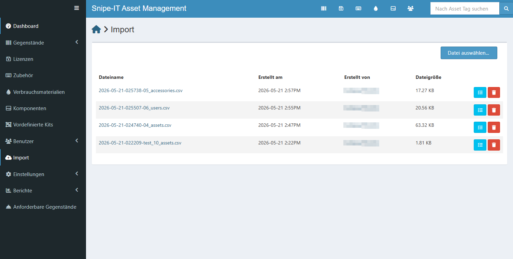
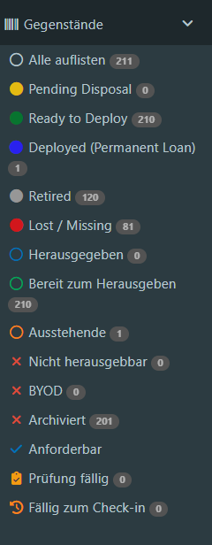
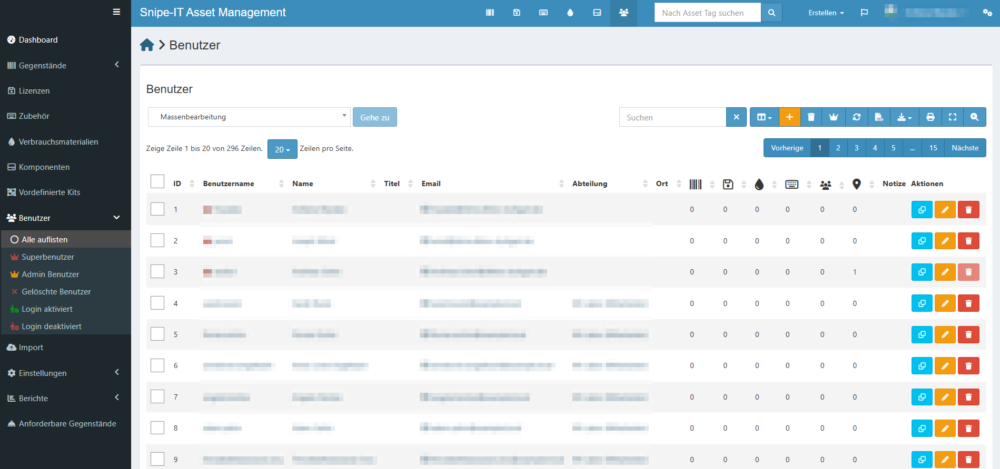
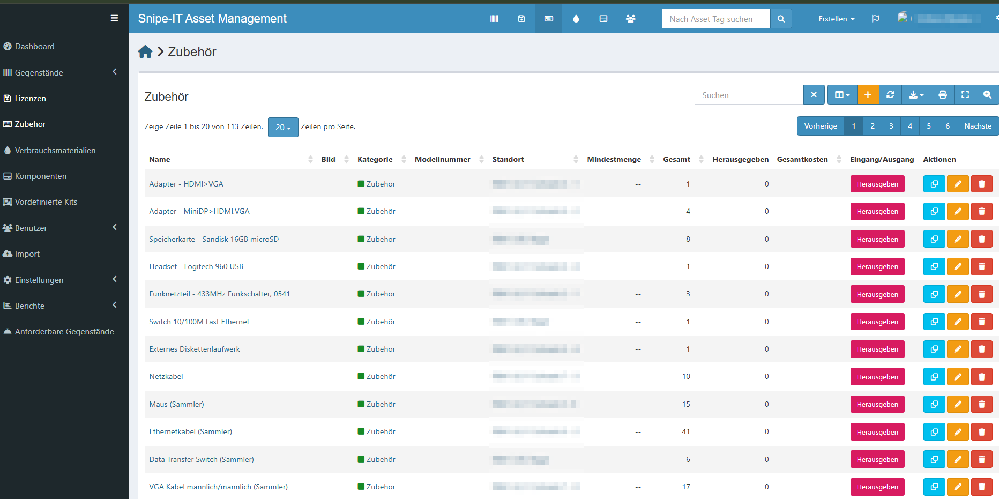
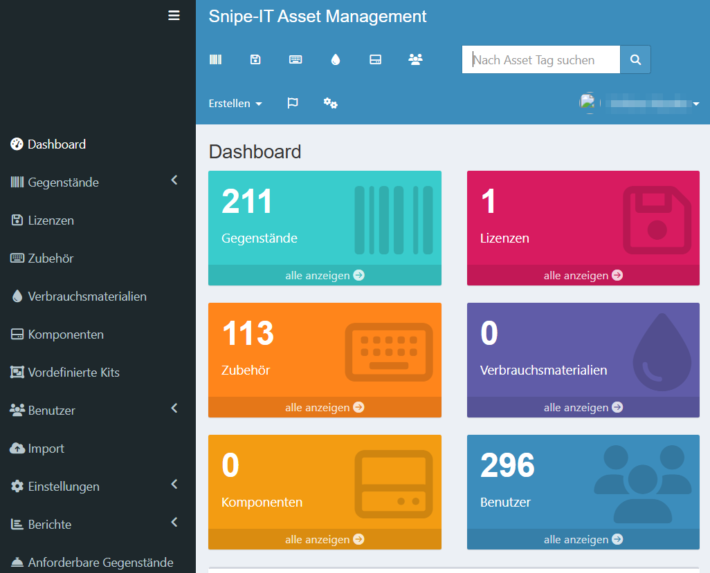

# 4 Datenmigration aus MS Access

[← Snipe-IT](03_snipe-it-installation.md) · [Übersicht](../README.md) · [Weiter: Konfiguration →](05_konfiguration.md)

## 4.1 Ausgangslage

Inventar und Ausleihen des IT-Labors wurden bisher in der Access-Datenbank `Ausleihe.accdb` gepflegt.
Die Analyse ergab **13 Tabellen**:

| Tabelle | Datensätze | Inhalt |
|---|---:|---|
| `Geräte` | 598 | Haupttabelle – alle Geräte |
| `Ausleihe` | 599 | Ausleihjournal (alle Jahre) |
| `ModellSpezifikation` | 236 | Modelle |
| `ModellTyp` | 221 | Zuordnung Typ ↔ Modell |
| `Inventur` | 193 | Inventurdaten |
| `Notebooks` | 167 | Zusatzdaten Notebooks (Software) |
| `Zubehör` | 153 | Stückzahlen Zubehör |
| `Kurse` | 84 | Kurse (für Entleiher) |
| `Ortsverzeichnis` | 79 | Lagerorte |
| `NotebookInstall` | 20 | OS-/Office-Images |
| `Ausgeber_Entgegennehmer` | 11 | Mitarbeitende des IT-Labors |
| `Leihfristen` | 9 | Leihfristen |
| `TypSpezifikation` | 3 | Hauptkategorien |

Verteilung der `Geräte`: **Notebook 181**, **Technik 229**, **Zubehör 188**.

## 4.2 Vorgehen

```
Access (.accdb) ──mdbtools──► CSV je Tabelle ──convert.py──► 6 Import-CSVs ──► Snipe-IT-Import ──► Kontrolle
```

1. **Export:** Da kein MS Access zur Verfügung stand, wurden die Tabellen unter Linux mit `mdbtools` als CSV exportiert.
2. **Konvertierung:** Das Python-Skript [`tools/migration/convert_access_to_snipeit.py`](../tools/migration/convert_access_to_snipeit.py)
   erzeugt daraus sechs importfertige Dateien (UTF-8 ohne BOM).
3. **Vorbereitung in Snipe-IT:** Statusbezeichnungen und benutzerdefinierte Felder vor dem Import anlegen (siehe [Kapitel 5](05_konfiguration.md)).
4. **Import** in fester Reihenfolge über *Admin → Importieren*.
5. **Kontrolle** der Anzahlen und Stichproben.

### Erzeugte Importdateien

| Datei | Zeilen | Quelle / Regel |
|---|---:|---|
| `01_locations.csv` | 111 | `Ortsverzeichnis` + zusätzliche Lagerorte aus `Geräte` |
| `02_manufacturers.csv` | 21 | aus Modellnamen erkannt (z. B. „ProBook“ → HP), sonst `Unknown` |
| `03_categories.csv` | 3 | Notebook (Asset), Technik (Asset), Zubehör (Accessory) |
| `04_assets.csv` | 410 | `Geräte` mit Typ Notebook/Technik – Einzelgeräte mit Asset-Tag |
| `05_accessories.csv` | 115 | `Geräte` mit Typ Zubehör, gruppiert nach Modell + Lagerort (537 Stück) |
| `06_users.csv` | 294 | 10 Mitarbeitende + 284 Entleiher, E-Mail-Platzhalter `@example.local` |

Die Dateien enthalten personenbezogene Daten und sind **nicht** in diesem Repository.

## 4.3 Feld-Mapping

### Geräte (Notebook, Technik) → Assets

| Access | Snipe-IT | Regel |
|---|---|---|
| `Gerätename` | Asset Tag | direkt (z. B. `WIINF-PB-01`) |
| `Typ` | Category | Notebook / Technik |
| `Modell` | Model Name | direkt (102 Modelle) |
| – | Manufacturer | aus Modellname ermittelt |
| `Seriennummer` | Serial | direkt |
| `Lagerort` | Location | direkt, `N.N.` → leer |
| `Kaufdatum` | Purchase Date | `YYYY-MM-DD` |
| `Bemerkung` | Notes | direkt |
| Flags (siehe 4.4) | Status | Mapping |
| `Aktuelle_Installation` | Custom Field *OS Installation* | nur Notebooks |
| `WIN_Office_aktuell` | Custom Field *Office Aktuell* | Ja / Nein |
| `GeräteID` | Custom Field *Inventarnummer (Altsystem)* | für Rückverfolgung |
| `Gerät` | Custom Field *Gerätetyp (Subtyp)* | z. B. Raspberry, Beamer |

### Zubehör → Accessories

Zubehör hat in Snipe-IT keine Einzel-Tags, sondern einen Bestand. Die 188 Zubehör-Datensätze wurden daher
nach **Modell + Lagerort** zu 115 Positionen zusammengefasst; die Stückzahl ergibt sich aus der Tabelle `Zubehör`.
Bemerkungen wurden ins Feld *Notes* übernommen (Accessories unterstützen keine benutzerdefinierten Felder).

## 4.4 Status-Mapping

| Zustand in Access | Status in Snipe-IT | Typ | Anzahl Import |
|---|---|---|---:|
| `Ausgesondert = 1` | Retired | Archiviert | 120 |
| `Auszusondern = 1` | Pending Disposal | Ausstehend | 0 |
| `Dauerleihe = 1` | Deployed (Permanent Loan) | Ausstehend | 1 |
| `Vorhanden = 1` | Ready to Deploy | Einsatzbereit | 206 |
| sonst | Lost / Missing | Archiviert | 83 |
| | | **Summe** | **410** |

> Die 83 Assets mit *Lost / Missing* sind auffällig hoch – vermutlich fehlt in Access nur das Flag `Vorhanden`.

## 4.5 Import

Der Import erfolgte am **21.05.2026** über *Import* (linkes Menü), „Willkommens-E-Mail senden“ **deaktiviert**.
Vorher wurde ein Backup erstellt (siehe Kapitel 6).

| Uhrzeit | Datei | Typ | Größe |
|---|---|---|---:|
| 14:22 | `test_10_assets.csv` | Assets – **Testimport** mit 10 Datensätzen | 1,81 KB |
| 14:47 | `04_assets.csv` | Assets – vollständig (410 Zeilen) | 63,32 KB |
| 14:55 | `06_users.csv` | Benutzer (294) | 20,56 KB |
| 14:57 | `05_accessories.csv` | Zubehör (115) | 17,27 KB |

Kategorien, Hersteller, Standorte und Modelle wurden **nicht separat importiert**: Snipe-IT legt fehlende
Einträge beim Asset-Import automatisch an. Die Dateien `01_locations.csv`, `02_manufacturers.csv` und
`03_categories.csv` dienten zur Vorab-Kontrolle; die drei Kategorien wurden manuell angelegt.

Nach dem Testimport wurden Modelle, Hersteller, Status und Standorte stichprobenartig geprüft,
erst danach folgte der vollständige Import.



## 4.6 Kontrolle und Nacharbeiten

**Doppelte Asset-Tags:** In `04_assets.csv` kamen zwei Gerätenamen doppelt vor
(„TP-Link TL-WR1502X …“ und „ELMO STEM-CAM MA-1 …“). Snipe-IT hat die zweite Zeile jeweils **ohne Fehlermeldung übersprungen**.
Die fehlenden Geräte wurden manuell angelegt:

| Asset-Tag | Gerät |
|---|---|
| INV0000409 | HDMI Repeater |
| INV0000410 | TP-Link TL-WR1502X |
| INV0000412 | ELMO STEM-CAM MA-1 |

**Doppelte Zubehör-Namen:** „Freenove“ und „Sensorkit X40“ kamen je zweimal (an verschiedenen Lagerorten) vor;
in Snipe-IT sind daher **113** statt 115 Zubehörpositionen vorhanden.

**Anzeige im Dashboard:** Die Kategorie-Übersicht zählt nur nicht archivierte Assets
(Notebook 57 = 181 − 108 Retired − 16 Lost; Technik 154 = 229 − 12 Retired − 67 Lost + manuell angelegte).






## 4.7 Nicht migriert

Das **Ausleihjournal** (`Ausleihe`, 599 Einträge) wurde nicht importiert: Snipe-IT bietet keinen Massenimport für
historische Aus- und Rückgaben. Die Historie bleibt in der Access-Datenbank als Archiv erhalten.

## 4.8 Ergebnis

| Typ | Import-CSV | In Snipe-IT |
|---|---:|---:|
| Standorte | 111 | 80 – nur tatsächlich verwendete Lagerorte (automatisch beim Import angelegt) |
| Hersteller | 21 | 31 – davon 10 Beispiel-Hersteller aus der Installation |
| Kategorien | 3 | 3 (+ „Misc Software“ für Lizenzen) |
| Assets | 410 | 408 importiert + 3 manuell |
| Zubehör | 115 | 113 |
| Benutzer | 294 | 296 (inkl. 3 Admin-Konten; 1 Benutzer gelöscht – prüfen) |
