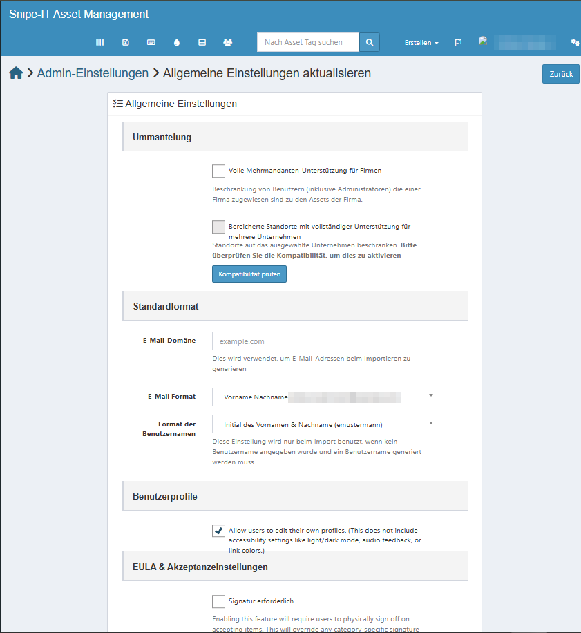
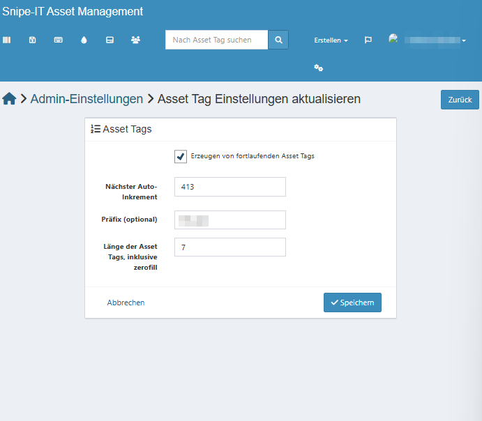
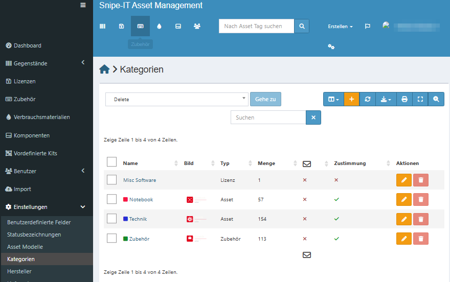
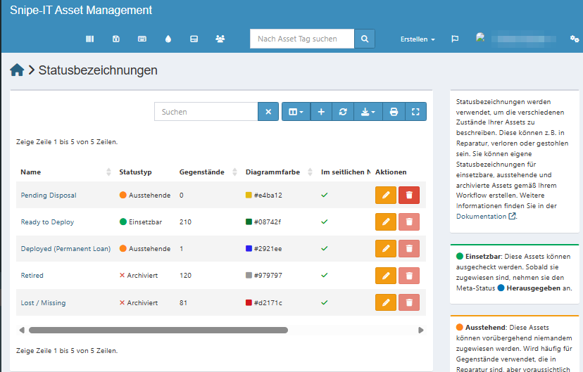
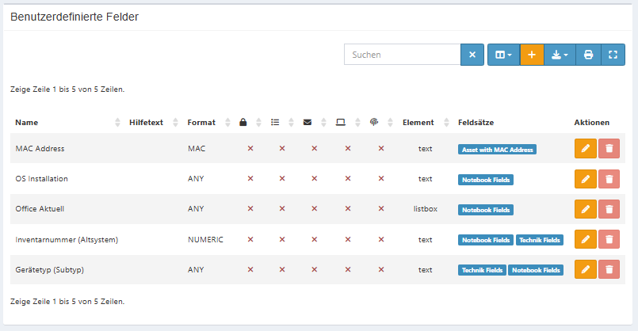
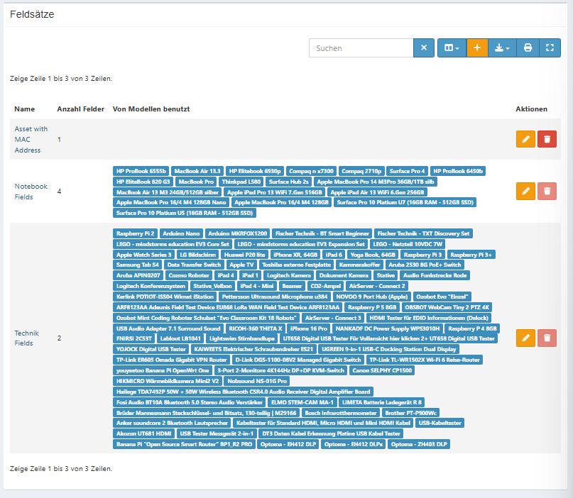

# 5 Konfiguration in Snipe-IT

[← Datenmigration](04_datenmigration.md) · [Übersicht](../README.md) · [Weiter: Backup →](06_backup-wartung.md)

Stand der Einstellungen: 05.10.2026.

## 5.1 Allgemeine Einstellungen

*Admin-Einstellungen (⚙ oben rechts) → Allgemeine Einstellungen*

| Einstellung | Wert |
|---|---|
| Mehrmandanten-Unterstützung für Firmen | aus |
| E-Mail-Domäne | leer (Platzhalter `example.com`) |
| E-Mail-Format | `Vorname.Nachname` |
| Format der Benutzernamen | Initial des Vornamens + Nachname (nur für Import ohne Benutzernamen) |
| Benutzer dürfen eigenes Profil bearbeiten | an |
| Signatur bei Annahme erforderlich | aus |

## 5.2 Asset-Tags

*Admin-Einstellungen → Asset Tags*

| Einstellung | Wert |
|---|---|
| Fortlaufende Asset-Tags erzeugen | an |
| Nächster Auto-Inkrement | 413 |
| Präfix | `INV` |
| Länge inkl. führender Nullen | 7 (z. B. `INV0000409`) |

Die automatische Nummerierung gilt nur für **neu angelegte** Geräte. Importierte Geräte behalten ihren
bisherigen Namen aus Access als Asset-Tag (z. B. `WIINF-PB-01`).

> Ursprünglich geplant war das Präfix `IT-` mit 6 Stellen. Die endgültige Festlegung ist noch offen.

## 5.3 Kategorien

*Einstellungen (linkes Menü) → Kategorien*

| Kategorie | Typ | Anzahl* | Annahme bestätigen |
|---|---|---:|---|
| Notebook | Asset | 57 | ja |
| Technik | Asset | 154 | ja |
| Zubehör | Zubehör | 113 | ja |
| Misc Software | Lizenz | 1 | nein |

\* Snipe-IT zählt hier nur nicht archivierte Assets (siehe Kapitel 4.6).
„Misc Software“ stammt aus den Beispieldaten der Installation.

## 5.4 Statusbezeichnungen

*Einstellungen → Statusbezeichnungen* – vor dem Import angelegt, passend zum Status-Mapping aus Access (Kapitel 4.4).

| Status | Statustyp | Assets | Farbe |
|---|---|---:|---|
| Ready to Deploy | Einsetzbar | 210 | `#08742f` |
| Deployed (Permanent Loan) | Ausstehend | 1 | `#2921ee` |
| Pending Disposal | Ausstehend | 0 | `#e4ba12` |
| Retired | Archiviert | 120 | `#979797` |
| Lost / Missing | Archiviert | 81 | `#d2171c` |

*Lost / Missing* hat 81 statt 83 Assets wie in der Importdatei: Die beiden übersprungenen Duplikate
(Kapitel 4.6) hatten diesen Status und wurden manuell neu angelegt.

## 5.5 Benutzerdefinierte Felder

*Einstellungen → Benutzerdefinierte Felder* – für Access-Daten ohne passendes Standardfeld.

| Feld | Format | Element | Feldsätze | Quelle in Access |
|---|---|---|---|---|
| OS Installation | ANY | Text | Notebook Fields | `Notebooks.Aktuelle_Installation` |
| Office Aktuell | ANY | Listbox (Ja/Nein) | Notebook Fields | `Notebooks.WIN_Office_aktuell` |
| Inventarnummer (Altsystem) | NUMERIC | Text | Notebook Fields, Technik Fields | `Geräte.GeräteID` |
| Gerätetyp (Subtyp) | ANY | Text | Notebook Fields, Technik Fields | `Geräte.Gerät` |
| MAC Address | MAC | Text | Asset with MAC Address | Beispieldaten, nicht verwendet |

Über **Inventarnummer (Altsystem)** lässt sich jedes Gerät eindeutig dem alten Access-Datensatz zuordnen.

## 5.6 Feldsätze

Ein Feldsatz bündelt benutzerdefinierte Felder und wird dem **Modell** zugeordnet.

| Feldsatz | Felder | Zugeordnete Modelle |
|---|---:|---|
| Notebook Fields | 4 | 19 Notebook-/Tablet-Modelle (z. B. HP ProBook 6555b, MacBook Pro, Surface Pro 10) |
| Technik Fields | 2 | alle übrigen Technik-Modelle (z. B. Raspberry Pi, Optoma-Beamer, LEGO Mindstorms) |
| Asset with MAC Address | 1 | keine – Beispieldaten |

Fehlt die Zuordnung am Modell, werden die Felder beim Gerät nicht angezeigt
(Beispiel: Modell „HDMI Repeater 4k2k 20m“).

## 5.7 E-Mail

Aktuell `MAIL_MAILER=log`: Benachrichtigungen werden nur in das Log geschrieben, nicht versendet.
Die Absender-Variablen sind noch nicht gesetzt (siehe Kapitel 3.7).
