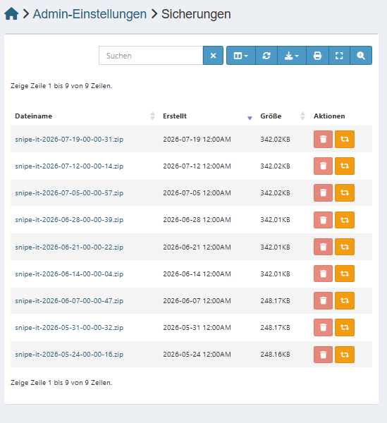

# 6 Backup und Wartung

[← Konfiguration](05_konfiguration.md) · [Übersicht](../README.md)

## 6.1 Backup über die Weboberfläche

*Admin-Einstellungen (⚙ oben rechts) → Sicherungen* → **Backup erstellen**. Das ZIP enthält Datenbank-Dump und hochgeladene Dateien.

Manuell erstellte und heruntergeladene Sicherungen:

| Datei | Inhalt |
|---|---|
| `backup_snipe-it-2026-05-21-10-57-14.zip` | 21.05.2026, 10:57 – Sicherung **vor** dem Datenimport (Import ab 14:22) |
| `backup_voll_snipe-it-2026-05-22-09-08-28.zip` | 22.05.2026 – vollständige Sicherung **nach** der Migration |

### Automatische Sicherungen

Snipe-IT erstellt über seinen internen Zeitplaner **wöchentlich** (sonntags 00:00 Uhr) ein Backup.
Sie liegen im Docker-Volume unter `/var/lib/snipeit/data/backups` und werden unter *Sicherungen* angezeigt.

| Zeitraum | Anzahl | Größe |
|---|---:|---|
| 24.05.2026 – 07.06.2026 | 3 | ca. 248 KB |
| 14.06.2026 – 19.07.2026 | 6 | ca. 342 KB (nach den Nacharbeiten im Juni) |

Seit dem **19.07.2026** sind keine weiteren Sicherungen entstanden, weil die VM gestoppt war
(Autostart aus, siehe Kapitel 1.3). Mit dem Neustart der VM am 05.10.2026 läuft der Zeitplan wieder.

> Die Sicherungen liegen auf derselben VM wie die Anwendung. Fällt die VM oder ihr Datenträger aus,
> sind auch die Backups verloren – eine Kopie auf einem anderen System ist notwendig.



### Ablage der Sicherungen

Backups und Access-Export enthalten personenbezogene Daten und gehören **nicht** in dieses Repository
(per `.gitignore` ausgeschlossen).


## 6.2 Backup über die Kommandozeile

```bash
cd ~/snipe-it   # /home/itadmin/snipe-it
# Snipe-IT-Backup (ZIP im Container unter /var/lib/snipeit/data/backups)
docker compose exec snipeit-app php artisan snipeit:backup

# reiner Datenbank-Dump
docker compose exec snipeit-db sh -c 'mariadb-dump -u root -p"$MYSQL_ROOT_PASSWORD" "$MYSQL_DATABASE"' > snipeit_$(date +%F).sql
```

Zusätzlich muss die `.env` (mit `APP_KEY`) gesichert sein.

## 6.3 Wiederherstellung

Admin → **Backups** → Backup hochladen → **Wiederherstellen**,
oder Dump einspielen:

```bash
docker compose exec -T snipeit-db sh -c 'mariadb -u root -p"$MYSQL_ROOT_PASSWORD" "$MYSQL_DATABASE"' < snipeit_JJJJ-MM-TT.sql
```

## 6.4 Nützliche Befehle

```bash
docker compose ps                      # Status
docker compose logs -f snipeit-app     # Logs
docker compose restart                 # Neustart
docker compose down && docker compose up -d   # Stoppen und neu starten
```

## 6.5 Update von Snipe-IT

1. Backup erstellen (6.1/6.2)
2. Image-Tag in `docker-compose.yml` anpassen (aktuell `latest`)
3. `docker compose pull && docker compose up -d`
4. Funktion und Version prüfen
